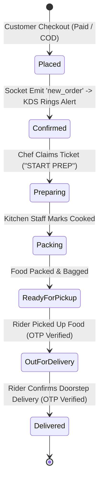

# 2QT — Enterprise Cloud-Kitchen, Dine-In & Food Delivery Platform

A full-stack, enterprise-grade food delivery, subscription meal-plan, and cloud-kitchen management platform. It powers the complete end-to-end food operations lifecycle — **Customer Ordering → Meal Plan Subscriptions → Table Bookings → Live Kitchen Prep (KDS) → Automated Rider Dispatch & Navigation → Cash-on-Delivery Settlements → Financial Ledger & Automated UPI Payouts** — across **one unified backend API** serving **five distinct applications**.

---

## 📑 Master Table of Contents

1. [Platform Overview & The 5 Apps Ecosystem](#-platform-overview--the-5-apps-ecosystem)
2. [Exhaustive Functional Modules & Technical Features](#-exhaustive-functional-modules--technical-features)
   - [1. Authentication, Security & Multi-Role RBAC](#1-authentication-security--multi-role-rbac)
   - [2. Customer Ordering & Server-Side Pricing Engine](#2-customer-ordering--server-side-pricing-engine)
   - [3. Subscription Meal Plans & Credit Scheduler](#3-subscription-meal-plans--credit-scheduler)
   - [4. Table Booking, Pre-Ordering & Dine-In POS](#4-table-booking-pre-ordering--dine-in-pos)
   - [5. Kitchen KDS & Multi-Tier Audio Siren Engine](#5-kitchen-kds--multi-tier-audio-siren-engine)
   - [6. Auto-Dispatch Engine & Real-Time GPS Tracking](#6-auto-dispatch-engine--real-time-gps-tracking)
   - [7. Rider Compensation, Salary & Incentive Engine](#7-rider-compensation-salary--incentive-engine)
   - [8. Cash-on-Delivery (COD) & Cash-in-Hand Settlement](#8-cash-on-delivery-cod--cash-in-hand-settlement)
   - [9. Kitchen Partner Onboarding & Profit-Share Portal](#9-kitchen-partner-onboarding--profit-share-portal)
   - [10. Admin Operations, Polygon Zones & Broadcasts](#10-admin-operations-polygon-zones--broadcasts)
   - [11. Finance Dashboard & 2-Step Payout Audit](#11-finance-dashboard--2-step-payout-audit)
   - [12. PDF Invoices, Wallet & Two-Way Referral System](#12-pdf-invoices-wallet--two-way-referral-system)
   - [13. Loyalty Tiers & Dynamic Point Multipliers](#13-loyalty-tiers--dynamic-point-multipliers)
   - [14. Customer Support & Automated Wallet Refunds](#14-customer-support--automated-wallet-refunds)
   - [15. Kitchen Equipment Maintenance Ticketing](#15-kitchen-equipment-maintenance-ticketing)
   - [16. Live Kitchen Camera Stream & FSSAI Hygiene Metrics](#16-live-kitchen-camera-stream--fssai-hygiene-metrics)
   - [17. Pre-Launch Teaser & Viral Waitlist Engine](#17-pre-launch-teaser--viral-waitlist-engine)
   - [18. App Boot Manager, Deep-Linking & Maintenance Controls](#18-app-boot-manager-deep-linking--maintenance-controls)
3. [System Architecture & Data Flow Diagrams](#-system-architecture--data-flow-diagrams)
4. [Exhaustive Monorepo Directory Map](#-exhaustive-monorepo-directory-map)
5. [Backend REST API Routes Index (33 Domains)](#-backend-rest-api-routes-index-33-domains)
6. [Mobile App Screen & Navigator Index (67+ Screens)](#-mobile-app-screen--navigator-index-67-screens)
7. [Database Schema & Migrations Overview](#-database-schema--migrations-overview)
8. [Quick Start & Flavor Setup Commands](#-quick-start--flavor-setup-commands)
9. [Complete Environment Variables Reference](#-complete-environment-variables-reference)

---

## 📱 Platform Overview & The 5 Apps Ecosystem

The platform operates as a unified monorepo. The Web frontend is a single Next.js 15 application containing all customer, administrative, kitchen, partner, and financial portals. The Mobile frontend is a single React Native application with role-driven navigators and dedicated Android build targets.

```
                                 ┌────────────────────────────────────────────────────────┐
                                 │                   UNIFIED BACKEND                      │
                                 │        Node.js · Express · TypeScript · PostgreSQL     │
                                 │      Redis · Socket.IO · BullMQ · Firebase FCM · RZP   │
                                 └───────────┬──────────────┬──────────────┬──────────────┘
                                             │              │              │
        ┌────────────────────────────────────┴──┐        ┌──┴──────────────┴────────────────────┐
        │          NEXT.JS 15 WEB PORTAL        │        │      REACT NATIVE MOBILE APP         │
        │     (Single Codebase / App Router)    │        │    (Role-Driven Navigators & Flavors)│
        └───────┬──────────┬──────────┬─────────┘        └───────┬──────────┬──────────┬────────┘
                │          │          │                          │          │          │
                ▼          ▼          ▼                          ▼          ▼          ▼
            Customer     Admin     Finance                    Customer    Rider     Kitchen
            PWA Web      Panel    Dashboard                    Flavor     Flavor    Flavor
```

| Application | Tech Stack | Primary Users | Functional Capabilities |
|---|---|---|---|
| **Customer Web PWA** | Next.js 15 (App Router), Tailwind CSS, Framer Motion | Customers | Menu browsing, item customization, promo codes, live order map tracking, wallet top-up, loyalty points, subscription meal plans, PDF invoices |
| **Kitchen KDS & Portal** | Next.js (`/kitchen` & `/kitchen-portal`) | Chefs, Kitchen Managers, Packers | Real-time KDS order tickets, Web Audio frequency-sweep sirens, 86 item availability toggles, morning prep checklist, shift handover reports, dine-in POS tickets |
| **Admin Control Center** | Next.js (`/admin`) | Super Admins, Operations | Live dispatch monitor, polygon zone drawer, kitchen hub management, rider contract configuration, push notification broadcasts, promo campaigns, menu manager |
| **Finance Dashboard** | Next.js (`/finance`) | Finance Team & Auditors | 2-step payout audit (`Pending` → `Approved` → `Paid`), COD cash settlements, transaction ledger, activity logs, RazorpayX instant UPI payouts |
| **Mobile App (3 Flavors)** | React Native (Fabric / New Arch), NativeWind, Redux, React Query | Customers, Riders, Staff, Admins | Role-driven navigators: `android:buyer` (Customer), `android:kitchen` (Kitchen Staff & KDS), `android:rider` (Riders & Fleet Captains) |

---

## ⚙️ Exhaustive Functional Modules & Technical Features

### 1. Authentication, Security & Multi-Role RBAC
- **Multi-Method Auth**: Phone OTP verification, Google OAuth, and Kitchen PIN quick authentication (`/auth/kitchen-pin`).
- **10 Fine-Grained User Roles**: `buyer`, `rider`, `rider_captain`, `chef`, `kitchen_manager`, `packer`, `super_admin`, `partner`, `support`, `dine_in_staff`.
- **Dual-Token Security**: Short-lived JWT access tokens + Redis-backed refresh token revocation lists.

### 2. Customer Ordering & Server-Side Pricing Engine
All checkout calculations are executed server-side in `backend/src/services/payment.service.ts`:
- **Subtotal & Add-ons**: Calculates item prices and customization options.
- **Delivery Fee**: Zone-configurable delivery fee (waived for active subscribers).
- **Promo Codes**: Percentage or flat discounts with minimum order thresholds.
- **Loyalty Redemption**: Points earned on orders converted to currency (capped at subtotal percentage).
- **GST Split**: 5% GST automatically split into 2.5% CGST + 2.5% SGST for legal compliance.
- **Wallet & Payment**: Supports Razorpay Checkout (UPI, Cards, NetBanking), wallet deduction, and Cash on Delivery (COD).

### 3. Subscription Meal Plans & Credit Scheduler
- Daily meal credit system allowing customers to subscribe to weekly or monthly plans.
- Interactive meal scheduling calendar allowing customers to select daily delivery slots or pause deliveries.
- Automated BullMQ cron triggers alerting customers when subscription credit balance drops low.

### 4. Table Booking, Pre-Ordering & Dine-In POS
- Customers can reserve tables and pre-order dishes for dine-in via Web or Mobile.
- Pre-order and post-order tickets are dispatched directly to the Kitchen KDS board.
- Table booking status management (`confirmed`, `preparing`, `served`, `completed`).

### 5. Kitchen KDS & Multi-Tier Audio Siren Engine
- **KDS Ticket Board**: Real-time status columns (New Orders → Cooking → Packing → Ready for Pickup).
- **Multi-Tier Siren Pipeline**:
  - *Web KDS*: Sawtooth frequency-sweep siren (Web Audio API 880Hz → 1760Hz) + HTML5 fallback (`/alert.mp3`). Includes interactive browser autoplay unlocking banner & 3-second sound debounce guard.
  - *Mobile App*: High-importance Notifee Android sound channel (`kitchen_orders`), custom native sound file (`kitchen_alarm.mp3`), and 6-second multi-pulse vibration pattern.
  - *Instant Silence*: Tapping **"ACCEPT"** or **"START PREP"** immediately triggers `stopKitchenAlert()`, stopping vibration and audio playback.
- **86 Item Availability**: One-tap toggle to mark menu items sold-out across all customer apps instantly.
- **Morning Prep Checklist**: Daily stock checklist and shift handover logs for kitchen managers.

### 6. Auto-Dispatch Engine & Real-Time GPS Tracking
- **Smart Dispatch**: Auto-assigns closest available rider within the delivery zone radius.
- **30-Second Assignment Sheet**: Riders receive a 30-second countdown sheet with alert sound and haptic pulse.
- **Real-Time GPS Heartbeat**: Rider devices stream location updates via Socket.IO (`update_location`), updating customer live tracking maps smoothly without HTTP polling.
- **Custom Native Leaflet WebView**: High-performance Leaflet map rendering in React Native without heavy native Google Maps SDK dependencies.

### 7. Rider Compensation, Salary & Incentive Engine
- **Per-Order (Gig Model)**:
  $$\text{Net Pay} = \left(\text{Base/Distance Pay} \times \text{Surge Multiplier}\right) + \text{100\% Customer Tip} - \text{10\% Platform Fee}$$
  - *Base Pay*: Fixed amount for trips within free distance (e.g. ₹35 for $\le 2\text{ km}$).
  - *Distance Pay*: Calculated per km using Google Maps road distance.
  - *Tips*: 100% passed to riders with zero platform deduction.
- **Monthly Salary Model**: Fixed monthly base salary + fuel allowance per km + 100% tips.
- **100% Manual Payout Control**: Monthly salary payouts are manually triggered by Admins (`POST /api/admin/riders/:id/pay-salary-now`) for total financial control.
- **Missions & Streaks**: Tiered cash rewards for daily targets (e.g. 5 orders = +₹50, 10 orders = +₹120) and daily minimum guarantee top-ups.
- **10-Point Edge-Case Safeguards**: Month-level duplicate payout protection (`SALARY_ALREADY_PAID_THIS_MONTH`), complaint deduction absorption, and safe gateway fallback.

### 8. Cash-on-Delivery (COD) & Cash-in-Hand Settlement
- Tracks COD cash collected by riders (`cash_collected_paise`).
- Automatically pauses cash order dispatches when rider reaches Cash-in-Hand limit (e.g. ₹2,000).
- Riders deposit cash at the Kitchen Counter or pay online via Razorpay. Kitchen Manager confirmation resets Cash-in-Hand to zero.

### 9. Kitchen Partner Onboarding & Profit-Share Portal
- Onboarding flow for franchisee and cloud-kitchen partner operators (`/partner`).
- Profit-share revenue analytics, table booking fee splits, and kitchen performance reports.

### 10. Admin Operations, Polygon Zones & Broadcasts
- Live dispatch monitor with manual rider re-assignment override.
- Interactive polygon zone drawer and kitchen hub management.
- Dynamic menu manager, category builder, promo code manager, and campaign banner manager.
- FCM targeted push notification broadcast engine (`admin-broadcast.ts`).

### 11. Finance Dashboard & 2-Step Payout Audit
- **2-Step Audit Flow**: Payouts move from `Pending` → `Approved` (by Finance Auditor) → `Paid` (Money moves).
- **RazorpayX Integration**: Instant automated UPI VPA transfers with real-time UTR tracking.
- Transaction ledgers and activity logging (`ActivityLogService`).

### 12. PDF Invoices, Wallet & Two-Way Referral System
- **Automated PDF Invoices**: Generates GST-compliant downloadable PDF invoices (`invoice.service.ts`).
- **Wallet Infrastructure**: Customer wallet top-ups, partial/full checkout usage, and instant refund credits.
- **Two-Way Referral System**: Referrers earn ₹50 wallet cash when referee completes their first order (`referral.service.ts`).

### 13. Loyalty Tiers & Dynamic Point Multipliers
- Multi-tier loyalty program (Bronze, Silver, Gold, Platinum) configured in `loyalty.service.ts`.
- Dynamic point multiplier per tier on completed orders with seamless checkout point redemption.

### 14. Customer Support & Automated Wallet Refunds
- In-app support chat widget for customers and riders (`support.ts`).
- Complaint classification engine (damaged food, missing item, delayed delivery).
- Automated wallet credit refund triggers (`complaints.ts`).

### 15. Kitchen Equipment Maintenance Ticketing
- Ticket tracking system for kitchen equipment breakdowns (deep fryers, ovens, POS printers).
- Status workflow (`open` → `in_progress` → `resolved`) in `service-requests.ts`.

### 16. Live Kitchen Camera Stream & FSSAI Hygiene Metrics
- Live video stream embedded in KDS and customer view (`/live-kitchen`).
- Displays FSSAI compliance score, staff temperature logs, sanitization percentage, and 100% pure veg certification status.

### 17. Pre-Launch Teaser & Viral Waitlist Engine
- Teaser landing page with early access waitlist (`prelaunch.ts`).
- Viral referral link generation and interest registration tracking.

### 18. App Boot Manager, Deep-Linking & Maintenance Controls
- **App Boot Manager**: Resolves user token, syncs device push tokens, and checks system flags.
- **Deep-Linking**: Handles custom scheme URLs (`velto://order/:id`, `velto://payout/:id`).
- **Maintenance & Force Update**: Remotely lock app versions via `ForceUpdateScreen` & `MaintenanceScreen`.

---

## 🏗️ System Architecture & Data Flow Diagrams

### Real-Time Socket.IO Multi-Room Architecture

```
                                  ┌────────────────────────┐
                                  │   Socket.IO Gateway    │
                                  │    (Redis Adapter)     │
                                  └───────────┬────────────┘
                                              │
         ┌──────────────────┬─────────────────┼──────────────────┬──────────────────┐
         ▼                  ▼                 ▼                  ▼                  ▼
  user:${userId}    kitchen:${kitchenId}    admin       riders:${zoneId}    order:${orderId}
  (Customer notifs)  (Live KDS Tickets)  (Live Dispatch) (Rider Auto-Assign) (Live GPS Heartbeat)
```

### Complete Order Lifecycle State Machine



---

## 📂 Exhaustive Monorepo Directory Map

```
VELTO_FOOD_PALACE/
├── backend/
│   ├── src/
│   │   ├── routes/          # 33 Domain Routes (admin, auth, rider, kitchen, finance, payment, support, etc.)
│   │   ├── services/        # Business Logic (order, payment, rider payout, loyalty, stock, invoice, referral…)
│   │   ├── socket/          # Socket.IO handlers & Redis pub/sub rooms
│   │   ├── modules/         # Modular notification strategies & FCM dispatchers
│   │   ├── redis/           # Redis client init, cache keys, pub/sub channels
│   │   ├── db/              # Database pool & 130+ SQL migration scripts
│   │   └── crons/           # Scheduled background jobs (guarantee top-up, daily auto-payout)
│   └── Dockerfile
│
├── web/                     # Next.js 15 Web App
│   └── app/
│       ├── page.tsx         # Customer Landing Page
│       ├── menu/            # Menu discovery & item customization modal
│       ├── orders/          # Live order map tracking & order history
│       ├── profile/         # Profile, wallet, loyalty points, PDF invoices, complaints
│       ├── subscription/    # Meal plan subscription calendar
│       ├── table-booking/   # Dine-in reservation & dish pre-ordering
│       ├── live-kitchen/    # Kitchen camera stream & FSSAI metrics
│       ├── admin/           # Admin control center (Menu, Zones, Kitchens, Riders, Promos, Dispatch, Finance)
│       ├── finance/         # Finance dashboard (Overview, Rider Payouts, Kitchen Payouts, COD)
│       ├── kitchen/         # Live KDS Order Board, Audio Sirens, Morning Prep, Dine-In POS
│       ├── partner/         # Kitchen partner onboarding portal
│       ├── become-a-rider/  # Rider onboarding application
│       └── prelaunch/       # Teaser waitlist page
│
└── mobile/                  # React Native App (All Roles)
    ├── android/app/src/main/res/raw/  # Audio resources (kitchen_alarm.mp3, rider_alert.mp3, alert.mp3)
    └── src/
        ├── navigation/      # Role-Based Navigators (Customer, Rider, Kitchen, Admin, Partner)
        ├── screens/         # 67+ Native Screens across all user roles
        ├── components/      # TrackingLeafletMap, AppBootManager, Header, Cards
        ├── utils/           # kitchenAlert.ts (Notifee sound channel, native player & vibration)
        └── services/        # Push notification handler, Socket client, DeepLinkResolver
```

---

## 📡 Backend REST API Routes Index (33 Domains)

| Route File | Domain | Key Endpoints |
|---|---|---|
| `auth.ts` | Authentication | Phone OTP, Google OAuth, Kitchen PIN (`/auth/kitchen-pin`), JWT Refresh |
| `order.ts` | Order Management | Checkout, delivery OTP verify, cancel & refund |
| `payment.ts` | Pricing & Payments | Server-side pricing engine, Razorpay order creation, payment verification |
| `rider.ts` | Rider Management | Duty toggle, live location streaming, earnings, cash submit, scorecard |
| `kitchen.ts` | Kitchen KDS | Active tickets, status transition, 86 availability, morning prep, stock |
| `admin.ts` | Admin Operations | Polygon zones, kitchen hubs, menu manager, rider contracts, manual salary pay |
| `finance.ts` | Financial Clearing | 2-step payout audit (`approve`, `pay`), COD settlements, transaction logs |
| `customer.ts` | Customer Services | Saved addresses, wallet top-up, PDF invoices, loyalty points |
| `subscription.ts` | Meal Plans | Plan creation, credit scheduling, delivery pause/resume |
| `table-bookings.ts`| Dine-In POS | Table reservation, dish pre-ordering, kitchen ticket dispatch |
| `complaints.ts` | Complaints | Ticket logging, classification, automated wallet refund triggers |
| `support.ts` | Support Chat | In-app support chat API for customers and riders |
| `partner.ts` | Kitchen Partners | Partner onboarding, profit-share revenue split, partner dashboard |
| `promocodes.ts` | Discounts | Coupon code creation & checkout validation |
| `campaigns.ts` | Marketing | Campaign management & dynamic homepage banners |
| `menu-offers.ts` | Item Offers | BOGO offers, item discounts, time-windowed deals |
| `missions.ts` | Rider Incentives | Rider daily/weekly missions & tier cash bonuses |
| `service-requests.ts`| Equipment Ticket | Kitchen equipment maintenance ticketing |
| `prelaunch.ts` | Early Access | Teaser waitlist & viral referral tracking |
| `admin-broadcast.ts`| FCM Broadcast | Targeted push notification broadcasts |
| `webhooks.ts` | Gateway Webhooks | Razorpay payment & RazorpayX payout webhooks |

---

## 📱 Mobile App Screen & Navigator Index (67+ Screens)

### Customer Navigator (`android:buyer`)
- `HomeScreen`, `CategoryScreen`, `SearchScreen`, `RestaurantDetailScreen`, `ItemDetailScreen`
- `CartScreen`, `CheckoutScreen`, `OrderPlacedScreen`, `OrderConfirmedScreen`, `OrderSavingsScreen`, `ScheduleOrderScreen`
- `TrackingScreen`, `DeliveryOTPScreen`, `DoorPaymentScreen`, `OrderHistoryScreen`, `RateOrderScreen`, `FeedbackScreen`
- `ProfileScreen`, `EditProfileScreen`, `AddressBookScreen`, `AddressScreen`
- `WalletScreen`, `LoyaltyScreen`, `ReferralScreen`, `MyPlansScreen`, `SubscriptionScreen`, `SubscriptionDetailScreen`, `RenewSubscriptionScreen`
- `TableBookingScreen`, `TableBookingDetailScreen`, `TableBookingConfirmedScreen`, `MyTableBookingsScreen`
- `SupportScreen`, `HelpScreen`, `NotificationsScreen`, `OnboardingScreen`, `LoginScreen`, `OTPScreen`, `SplashScreen`

### Rider Navigator (`android:rider`)
- `RiderHomeScreen`, `AssignedOrderScreen`, `BatchViewScreen`, `CreateBatchScreen`
- `EarningsScreen`, `PayoutsScreen`, `CashSubmitScreen`, `RiderScorecardScreen`, `RiderMissionsScreen`
- `RiderDocumentsScreen`, `RiderOnboardingScreen`, `RiderHistoryScreen`, `RiderNotificationsScreen`, `RiderSupportScreen`, `RiderHelpScreen`

### Kitchen Navigator (`android:kitchen`)
- `KitchenBoardScreen`, `LiveKitchenScreen`, `MorningPrepScreen`, `StockScreen`, `ShiftHandoverScreen`
- `KitchenDineInScreen`, `KitchenManageScreen`, `KitchenLoginScreen`, `KitchenClosedScreen`, `PackerScreen`

### Admin & Partner Navigators
- Admin: `DashboardScreen`, `AdminLiveOrdersScreen`, `MenuManagerScreen`, `AdminRidersScreen`, `AdminPayoutsScreen`, `BroadcastScreen`
- Partner: `PartnerDashboardScreen`, `PartnerBookingsScreen`, `PartnerEarningsScreen`

---

## 🗄️ Database Schema & Migrations Overview

The database uses PostgreSQL 15+ with 130+ sequential migration scripts located in `backend/migrations/`:
- **Core Entities**: `users`, `kitchens`, `zones`, `menu_items`, `menu_categories`, `orders`, `order_items`
- **Rider Financials**: `rider_daily_earnings`, `weekly_payouts`, `rider_missions`, `cash_settlements`
- **Subscriptions & Dine-In**: `subscription_plans`, `customer_subscriptions`, `table_bookings`, `table_booking_items`
- **Customer Rewards**: `wallets`, `wallet_transactions`, `loyalty_points`, `referral_rewards`, `invoices`
- **Auditing**: `activity_logs`, `complaints`, `service_requests`, `notification_templates`

---

## 🛠️ Quick Start & Setup Guide

### 1. Prerequisites
- Node.js 20+
- PostgreSQL 15+
- Redis 7+
- Android Studio / Xcode

### 2. Backend Installation
```bash
cd backend
cp .env.example .env   # Fill DB, Redis, Razorpay, Firebase keys
npm install
npm run dev            # API starts on http://localhost:8000
```

### 3. Web Application
```bash
cd web
cp .env.example .env.local
npm install
npm run dev            # Next.js starts on http://localhost:3000
```

### 4. Mobile Application (Build Targets)
```bash
cd mobile
npm install

# Build & launch target app flavor:
npm run android:buyer     # Launch Customer App
npm run android:kitchen   # Launch Kitchen KDS App
npm run android:rider     # Launch Rider App
```

### 5. Docker Deployment
```bash
docker-compose up -d
```

---

## 🗝️ Environment Variables Reference

| Variable | Used By | Purpose |
|---|---|---|
| `DATABASE_URL` | Backend | PostgreSQL database connection string |
| `REDIS_URL` | Backend | Redis URL (BullMQ queues & Socket.IO adapter) |
| `JWT_SECRET` | Backend | JWT signing & access token verification |
| `RAZORPAY_KEY_ID / SECRET` | Backend | Razorpay payment gateway credentials |
| `RAZORPAY_ACCOUNT_NUMBER` | Backend | RazorpayX UPI payout account number |
| `FIREBASE_SERVICE_ACCOUNT` | Backend | FCM push notification service JSON |
| `CLOUDINARY_URL` | Backend | Image and asset upload destination |
| `NEXT_PUBLIC_API_URL` | Web | Backend REST API base URL |
| `NEXT_PUBLIC_RAZORPAY_KEY` | Web | Client-side Razorpay key |
| `API_BASE_URL` | Mobile | Backend base URL for mobile API client |

---

## 📄 License

Private repository — all rights reserved.
